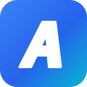
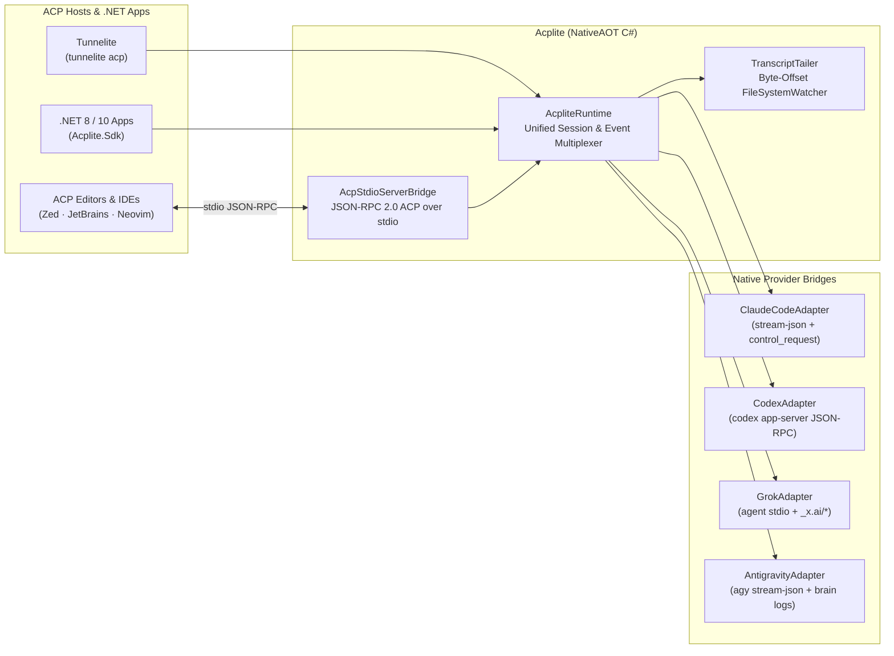

<p align="center">
  <a href="https://github.com/cristipufu/acplite">
    
  </a>
</p>

<h1 align="center">Acplite</h1>

<p align="center">
  <strong>Your coding agents. One protocol away.</strong><br>
  Native C# / NativeAOT Agent Client Protocol (ACP) SDK and CLI bridges for <strong>Claude Code</strong>, <strong>OpenAI Codex</strong>, <strong>Grok</strong>, and <strong>Google Antigravity</strong>.
</p>

<p align="center">
  <a href="https://github.com/cristipufu/acplite/releases/latest"></a>
  <a href="https://www.nuget.org/packages/Acplite/"></a>
  <a href="https://www.nuget.org/packages/Acplite.Sdk/"></a>
  <a href="https://github.com/cristipufu/acplite/actions/workflows/ci.yml"></a>
  <a href="LICENSE"></a>
</p>

<p align="center">
  <a href="#quick-start-cli"><strong>Get started</strong></a> &nbsp;·&nbsp;
  <a href="#supported-coding-agents">Providers</a> &nbsp;·&nbsp;
  <a href="#c-sdk-usage">C# SDK</a> &nbsp;·&nbsp;
  <a href="#stdio-acp-bridge-for-editors--hosts">Stdio Bridge</a> &nbsp;·&nbsp;
  <a href="#architecture">Architecture</a>
</p>

<p align="center">
  <a href="#installation"></a>
  <a href="#installation"></a>
  <a href="#installation"></a>
</p>

<p align="center">
  <sub>Claude Code · OpenAI Codex · Grok · Google Antigravity · JSON-RPC 2.0 ACP</sub>
</p>

---

## Why Acplite?

Most coding agent CLIs (`claude`, `codex`, `agy`) don't speak the [Agent Client Protocol (ACP)](https://agentclientprotocol.com) natively. **Acplite** bridges them directly in C# with zero Node.js wrappers, so you can control any local coding agent through one unified interface:

- **One API for 4 Agents**: Bridges `claude`, `codex`, `grok`, and `agy` into a single strongly-typed ACP event stream.
- **SDK + `stdio` Server**: Embed `Acplite.Sdk` in your .NET app or run `acplite serve <provider>` for Zed, JetBrains, or Neovim.
- **Live Session Discovery & Tailing**: Finds local sessions on disk and live-tails `.jsonl` transcripts in real time without locking files.
- **Mid-Turn Steering & Quota Probes**: Steer active turns on the fly, approve tool calls, and check 5h / 7d rate-limit windows.

---

## Supported Coding Agents

| Provider | ID | Native CLI Protocol Bridged | Local Session & Live Tail Discovery | Mid-Turn Steering | Quota / Usage Probe |
| :--- | :--- | :--- | :--- | :--- | :--- |
| **Claude Code** | `claude` | `claude --print --input-format stream-json --output-format stream-json --verbose` | `~/.claude/projects/<slug>/*.jsonl` | Live `user` stream frame | `control_request` (`get_usage`) & OAuth metadata |
| **OpenAI Codex** | `codex` | `codex app-server` (`thread/start`, `thread/resume`, `turn/start`) | `~/.codex/sessions/YYYY/MM/DD/rollout-*.jsonl` | `turn/steer` (`expectedTurnId`) | `account/rateLimits/read` |
| **xAI Grok** | `grok` | `grok --permission-mode auto agent stdio` (ACP + `_x.ai/*`) | `~/.grok/sessions/*.jsonl` | `_x.ai/interject` | `_x.ai/billing` |
| **Google Antigravity** | `agy` | `agy --conversation <id> -p --input-format stream-json --output-format stream-json` | `~/.gemini/antigravity-cli/brain/<id>/.system_generated/logs/transcript.jsonl` | Live `user` stream frame | Session activity metadata |
| **Generic ACP** | `acp` | Any standard ACP-compliant binary over `stdio` | `session/list` RPC | `_session/steering` | Standard ACP usage metadata |

---

## Installation

### .NET Global Tool (`acplite` CLI)

```bash
dotnet tool install --global Acplite
```

### NuGet Library (`Acplite.Sdk`)

```bash
dotnet add package Acplite.Sdk
```

### Standalone Binaries

Every [release](https://github.com/cristipufu/acplite/releases/latest) also ships a single self-contained executable, built with NativeAOT, that needs no .NET runtime installed:

| Platform | Archive |
| --- | --- |
| Linux x64 | `acplite-linux-x64.tar.gz` |
| Linux arm64 | `acplite-linux-arm64.tar.gz` |
| macOS Intel | `acplite-osx-x64.tar.gz` |
| macOS Apple Silicon | `acplite-osx-arm64.tar.gz` |
| Windows x64 | `acplite-win-x64.zip` |

---

## Quick Start (CLI)

```bash
# 1. Discover installed coding agents on your machine
acplite providers

# 2. List active & recent sessions across Claude, Codex, Grok, and Antigravity
acplite sessions
acplite sessions agy

# 3. Live-tail an active terminal session in real time
acplite tail <session-id>

# 4. Run or resume a session interactively
acplite run claude "Refactor the auth middleware to use SemaphoreSlim" --cwd /path/to/repo
acplite run agy "Add unit tests for the new parser" --session <conversation-id>

# 5. Check account rate-limit & quota windows
acplite usage
```

---

## C# SDK Usage

```csharp
using Acplite.Sdk;
using Acplite.Sdk.Protocol;

await using var runtime = new AcpliteRuntime();

// 1. Discover installed providers & recent local sessions
var providers = await runtime.DiscoverProvidersAsync(cancellationToken: ct);
var sessions = await runtime.DiscoverSessionsAsync(providerFilter: null, maxSessionsPerProvider: 25, ct);

// 2. Start or resume a session on any provider
await using var session = await runtime.StartSessionAsync(new AcpSessionConfig
{
    Provider = AgentProviderKind.Claude,
    WorkingDirectory = "/Users/me/project",
    SessionId = sessions.FirstOrDefault()?.SessionId,
    ResumeExisting = true,
    AutoApproveTools = false
}, ct);

// 3. Stream unified events (thinking, text deltas, tool calls, permission requests)
_ = Task.Run(async () =>
{
    await foreach (var ev in session.ReadEventsAsync(ct))
    {
        switch (ev)
        {
            case AcpThinkingDeltaEvent thought:
                Console.Write(thought.Delta);
                break;
            case AcpAssistantTextDeltaEvent text:
                Console.Write(text.Delta);
                break;
            case AcpPermissionRequestEvent perm:
                await session.RespondPermissionAsync(perm.RequestId, approved: true, cancellationToken: ct);
                break;
        }
    }
});

// 4. Send a prompt and steer mid-turn while the agent is working
await session.SendPromptAsync("Inspect the failing tests and fix the race condition.", ct);
await session.SteerAsync("Use SemaphoreSlim instead of lock.", ct);
```

---

## Stdio ACP Bridge for Editors & Hosts

Run `acplite serve <provider>` to expose any supported CLI as a standards-compliant ACP JSON-RPC 2.0 server over `stdin`/`stdout` for **Zed**, **JetBrains**, **Neovim**, or any ACP host:

```json
{
  "agent_servers": {
    "claude": {
      "command": "acplite",
      "args": ["serve", "claude"]
    },
    "codex": {
      "command": "acplite",
      "args": ["serve", "codex"]
    },
    "antigravity": {
      "command": "acplite",
      "args": ["serve", "agy"]
    },
    "grok": {
      "command": "acplite",
      "args": ["serve", "grok"]
    }
  }
}
```

---

## Architecture



---

## .NET Packages

| Package | Description |
| --- | --- |
| [Acplite](https://www.nuget.org/packages/Acplite/) | The `acplite` command-line tool and `stdio` ACP server bridge. |
| [Acplite.Sdk](https://www.nuget.org/packages/Acplite.Sdk/) | `AcpliteRuntime` and native C# ACP adapters for `claude`, `codex`, `grok`, and `agy`. |

---

## Development

```bash
dotnet build -c Release
dotnet test test/Acplite.Tests -c Release --no-build
```

## License

This project is licensed under the [MIT License](LICENSE).
